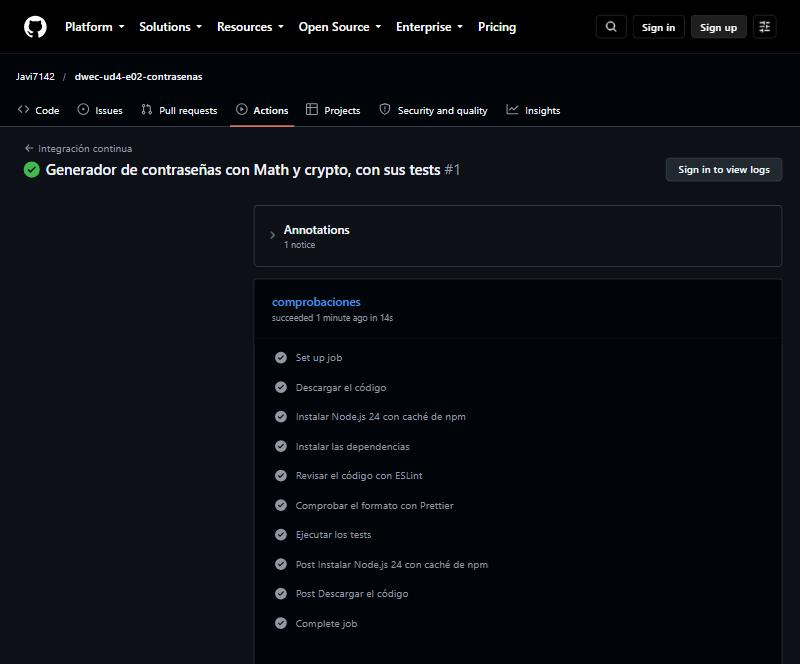
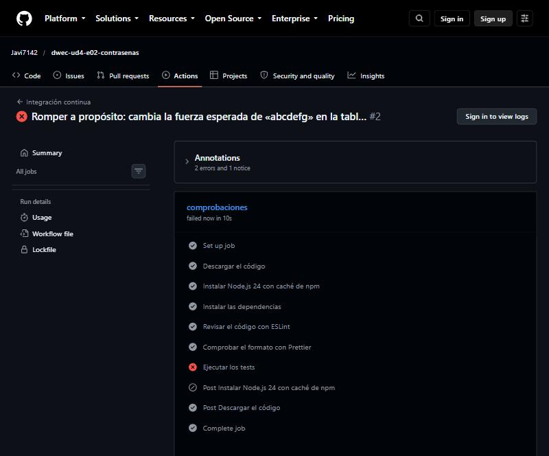

# Generador de contraseñas

Repositorio del ejercicio: <https://github.com/Javi7142/dwec-ud4-e02-contrasenas>

## Cómo ejecutarlo

Desde la carpeta del ejercicio, en el Dev Container (o en cualquier equipo con Node.js 24):

```bash
npm install            # instala las dependencias (el contenedor ya lo hace al crearse)
npm start              # demostración (src/main.js)
npm test               # tests con Vitest
npm run lint           # ESLint
npm run format         # Prettier: formatea el código
npm run format:check   # Prettier: solo comprueba el formato
```

## Salida

```text
🔑 38TOY0amDKM4     · 12 caracteres · fuerte
🔑 DxWT9rnnm*lxf0k& · 16 caracteres · fuerte
🔑 xrirex           · 6 caracteres · débil
🧪 abc              · débil
🧪 abcdefghijkl     · media
🧪 abcdefgh1        · media
🧪 Abcdefgh1234!    · fuerte
🎲 Con crypto: 20 caracteres
❌ RangeError: Longitud no válida: 3
```

Las tres primeras contraseñas son siempre las mismas porque la demostración usa `crearAleatorioConSemilla(2025)`; la línea «Con crypto» usa `crypto.getRandomValues`, así que su contraseña cambia en cada ejecución (siempre con 20 caracteres). En `contrasenas.js` no aparece `Math.random`.

## Tests

Salida de `npx vitest run --reporter=verbose` (es `npm test` con el nombre de cada test a la vista):

```text

 RUN  v5.0.5 /w

 ✓ generarContrasena > tiene 12 caracteres por defecto 2ms
 ✓ generarContrasena > acepta la longitud límite 4 0ms
 ✓ generarContrasena > acepta la longitud límite 128 0ms
 ✓ generarContrasena > lanza un RangeError con la longitud no válida 3 1ms
 ✓ generarContrasena > lanza un RangeError con la longitud no válida 129 0ms
 ✓ generarContrasena > lanza un RangeError con la longitud no válida 0 0ms
 ✓ generarContrasena > lanza un RangeError con la longitud no válida -5 0ms
 ✓ generarContrasena > lanza un RangeError con la longitud no válida 12.5 0ms
 ✓ generarContrasena > lanza un RangeError con la longitud no válida 12 0ms
 ✓ generarContrasena > lanza un RangeError con la longitud no válida NaN 0ms
 ✓ generarContrasena > incluye un carácter de cada tipo por defecto, incluso con un azar que siempre devuelve 0 0ms
 ✓ generarContrasena > incluye un símbolo cuando se piden, incluso con un azar que siempre devuelve 0 0ms
 ✓ generarContrasena > con un azar que siempre devuelve 0 y 4 caracteres tiene exactamente uno de cada grupo 0ms
 ✓ generarContrasena > con un azar casi 1 (el valor más alto posible) no se sale de los grupos 0ms
 ✓ generarContrasena > sin mayúsculas, números ni símbolos usa solo minúsculas 0ms
 ✓ generarContrasena > con la misma semilla produce la misma contraseña 0ms
 ✓ generarContrasena > con semillas distintas produce contraseñas distintas 0ms
 ✓ generarContrasena > baraja el resultado: los obligatorios no quedan siempre al principio 0ms
 ✓ generarContrasena > no usa Math.random 1ms
 ✓ numeroAleatorio > usa crypto.getRandomValues 2ms
 ✓ numeroAleatorio > devuelve 0 con el entero más bajo y un valor menor que 1 con el más alto 0ms
 ✓ numeroAleatorio > generarContrasena con el azar por defecto llama a crypto.getRandomValues 2ms
 ✓ crearAleatorioConSemilla > produce siempre la misma secuencia para la misma semilla 0ms
 ✓ crearAleatorioConSemilla > produce números en [0, 1) 0ms
 ✓ evaluarFuerza > «abcdefg» es débil 0ms
 ✓ evaluarFuerza > «abcdefgh» es débil 0ms
 ✓ evaluarFuerza > «abcdefghijk» es débil 0ms
 ✓ evaluarFuerza > «abcdefghijkl» es media 0ms
 ✓ evaluarFuerza > «abcdefg1» es media 0ms
 ✓ evaluarFuerza > «Abcdef1» es media 0ms
 ✓ evaluarFuerza > «Abcde1!» es media 0ms
 ✓ evaluarFuerza > «Abcdefgh1234!» es fuerte 0ms
 ✓ evaluarFuerza > «» es débil 0ms

 Test Files  1 passed (1)
      Tests  33 passed (33)
   Start at  19:56:34
   Duration  446ms (import 47%, transform 22%, worker 18%, tests 13%)

```

| `describe` | Qué comprueba | Cómo controla el azar |
|------------|---------------|-----------------------|
| `generarContrasena` | Longitud por defecto (12) y límites (4 y 128); longitudes no válidas (3, 129, 0, −5, 12.5, `'12'`, `NaN`) con `toThrow(RangeError)`; un carácter de cada tipo pedido; solo minúsculas cuando se desactivan los demás grupos; misma semilla → misma contraseña; barajado; que no se llama a `Math.random` | Pasa como segundo parámetro un azar fijo: `() => 0` (siempre el primer carácter de cada grupo, que garantiza la variedad incluso en el peor caso), `() => 0.9999999` (el último carácter de cada grupo) o `crearAleatorioConSemilla(n)` (secuencia siempre igual para una semilla) |
| `numeroAleatorio` | Que usa `crypto.getRandomValues`, que devuelve `0` con el entero más bajo y un valor menor que 1 con el más alto, y que `generarContrasena` sin azar propio lo llama | Sustituye `crypto.getRandomValues` con `vi.spyOn(crypto, 'getRandomValues').mockImplementation(…)` para devolver enteros conocidos (`2 ** 31` → `0.5`); el `afterEach` ejecuta `vi.restoreAllMocks()` para deshacer el mock |
| `crearAleatorioConSemilla` | Misma semilla → misma secuencia; todos los números están en [0, 1) | No hay azar: el generador con semilla es determinista |
| `evaluarFuerza` | Tabla `it.each` con los casos límite de longitud: 7, 8, 11 y 12 caracteres; combinaciones de tipos (dos, tres y cuatro); texto vacío | No usa azar: es una función pura de la contraseña |

## ¿Detectan errores tus tests?

Cambié temporalmente `longitud < 4` por `longitud < 3` en `generarContrasena` y ejecuté `npm test`:

```text
     × lanza un RangeError con la longitud no válida 3 5ms
⎯⎯⎯⎯⎯⎯⎯ Failed Tests 1 ⎯⎯⎯⎯⎯⎯⎯
 FAIL  tests/contrasenas.test.js > generarContrasena > lanza un RangeError con la longitud no válida 3
AssertionError: expected function to throw an error, but it didn't
      Tests  1 failed | 32 passed (33)
```

Falla el test `generarContrasena > lanza un RangeError con la longitud no válida 3` (de la tabla `it.each` de longitudes no válidas): con el cambio, la longitud 3 deja de ser un error y la función devuelve una contraseña en lugar de lanzar `RangeError`. Después deshice el cambio y los 33 tests vuelven a pasar.

## Herramientas

```text

> e02-contrasenas@1.0.0 lint
> eslint .


> e02-contrasenas@1.0.0 format:check
> prettier --check .

Checking formatting...
All matched files use Prettier code style!
```

## Integración continua (opcional)

El workflow está en [`.github/workflows/ci.yml`](.github/workflows/ci.yml): un único trabajo en `ubuntu-latest` con los pasos «Descargar el código», «Instalar Node.js 24 con caché de npm», «Instalar las dependencias» (`npm ci`), «Revisar el código con ESLint», «Comprobar el formato con Prettier» y «Ejecutar los tests».

1. **Ejecución en verde:** <https://github.com/Javi7142/dwec-ud4-e02-contrasenas/actions/runs/40573680767>
2. **Captura de la ejecución en verde con sus pasos:**

   

3. **Ejecución en rojo provocada a propósito:** <https://github.com/Javi7142/dwec-ud4-e02-contrasenas/actions/runs/40573741572>. Cambié en `tests/contrasenas.test.js` la fuerza esperada de `'abcdefg'` en la tabla de `evaluarFuerza` (de `'débil'` a `'fuerte'`) y lo subí: la ejecución falló en el paso **«Ejecutar los tests»**, con ESLint y Prettier todavía en verde.

   

   Después deshice el cambio y la ejecución volvió a verde: <https://github.com/Javi7142/dwec-ud4-e02-contrasenas/actions/runs/40573785020>.
